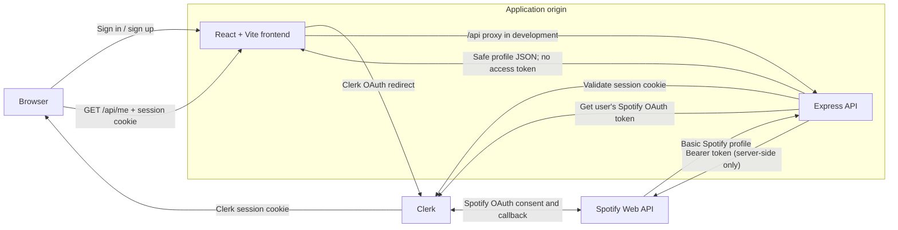

# Aftertone

Aftertone is a personal music diary: a place to explore listening history and connect songs with the days, seasons, and life moments around them.

The app uses Clerk for Spotify sign-in. The React frontend sends same-origin requests to the Express backend, which validates the Clerk session and uses the user's Spotify OAuth token server-side.

## Project layout

```text
backend/   Express API and production web server
frontend/  React application built with Vite
```

Each project has its own `package.json`, dependencies, and commands.

## Authentication architecture



In development, Vite proxies `/api` to Express. In production, Express serves the built frontend and API from the same origin. The Spotify access token stays on the backend and is never returned to browser code.

## Clerk and Spotify configuration

1. Create or select a Spotify app, then in the linked Clerk application enable Spotify as a social connection. Configure the Spotify OAuth credentials and the callback URL shown by Clerk.
2. Request the Spotify scopes `user-read-email` and `user-read-private` so `/api/me` can read the signed-in Spotify profile.
3. Ensure the frontend has `VITE_CLERK_PUBLISHABLE_KEY` in `frontend/.env.local`. Clerk CLI initialization may have created this file; do not commit it. Vite only exposes variables prefixed with `VITE_`.
4. Copy `backend/.env.example` to `backend/.env` and set `CLERK_PUBLISHABLE_KEY` and `CLERK_SECRET_KEY` from the Clerk Dashboard. Keep the secret key only in the backend environment.

```sh
cp backend/.env.example backend/.env
```

If you need to create the frontend environment file manually, copy `frontend/.env.example` to `frontend/.env.local` and set its publishable key.

The frontend shows Clerk sign-in/sign-up controls and a signed-in user menu. `GET /api/me` returns the Clerk user ID and basic Spotify profile fields; it returns `401` without a signed-in session and `403` if that Clerk user has no Spotify connection.

## Requirements

- Node.js 20.19+ or 22.12+
- npm

## Install

From the repository root:

```sh
cd backend
npm install
cd ../frontend
npm install
```

## Run locally

Configure the environment variables above, then open two terminals from the repository root.

Terminal 1 — backend:

```sh
cd backend
npm run dev
```

Terminal 2 — frontend:

```sh
cd frontend
npm run dev
```

Open <http://localhost:8080> for the home page. Vite forwards `/api` requests to the backend at `http://localhost:3030`.

Check backend health:

```sh
curl http://localhost:3030/api/health
```

The endpoint returns `{"status":"ok"}`. The same endpoint is available through the frontend proxy at <http://localhost:8080/api/health>. After signing in from the frontend with Spotify, the app calls `/api/me` through that same-origin proxy and displays the Spotify profile returned by the backend.

## Tests and builds

Run the frontend Cypress component test:

```sh
cd frontend
npm run test:component
```

Open Cypress interactively with `npm run test:component:open`. Build either project with `npm run build` from its directory.

## Production

Build the frontend first, then build and start the backend:

```sh
cd frontend
npm run build
cd ../backend
npm run build
npm start
```

Express serves the compiled frontend from `frontend/dist/` and the API from the same host. The API listens on port `3030` by default; set `PORT` to override it.
